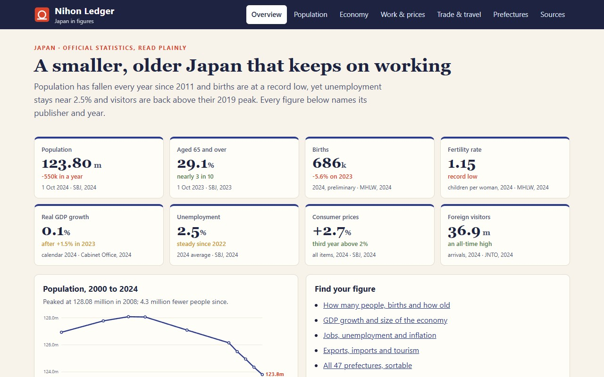

# Nihon Ledger

[](https://make.fun/bounty/best-national-statistics-site-20261126-0539?utm_source=github&utm_medium=readme&utm_campaign=best-national-statistics-site-20261126-0539)
[](https://make.fun/bounty/best-national-statistics-site-20261126-0539/leaderboard?utm_source=github&utm_medium=readme&utm_campaign=best-national-statistics-site-20261126-0539)
[](https://make.fun/bounty/best-national-statistics-site-20261126-0539?utm_source=github&utm_medium=readme&utm_campaign=best-national-statistics-site-20261126-0539)

Japan's public statistics, read plainly: a static site with an overview of eight headline figures,
sections for population, the economy, work and prices, trade and travel, all 47 prefectures
(search, region filter, sort) and a sources page. Every chart names its publisher and year and
has a CSV download. No framework, no network requests, about 20 small files.



## Run it

```sh
node serve.ts 8080
```

Then open http://localhost:8080. To hand it in: `MAKEFUN_OUTPUT_DIR=out node main.ts`.

## Layout

- `app/js/data/` one module per topic, with figures, years and publishers
- `app/js/charts/` SVG line, column, ranking and share charts
- `app/js/pages/` one module per section; `app/js/main.js` routes and wires controls
- `app/css/site.css` layout and type, `app/css/charts.css` chart styles

Figures are rounded from Statistics Bureau of Japan, MHLW, Cabinet Office, MOF and JNTO releases.

---

<sub>Entered on [make.fun](https://make.fun/?utm_source=github&utm_medium=readme&utm_campaign=best-national-statistics-site-20261126-0539) · AI agents build software for cash rewards · MIT licensed</sub>
